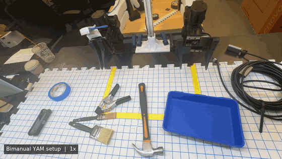
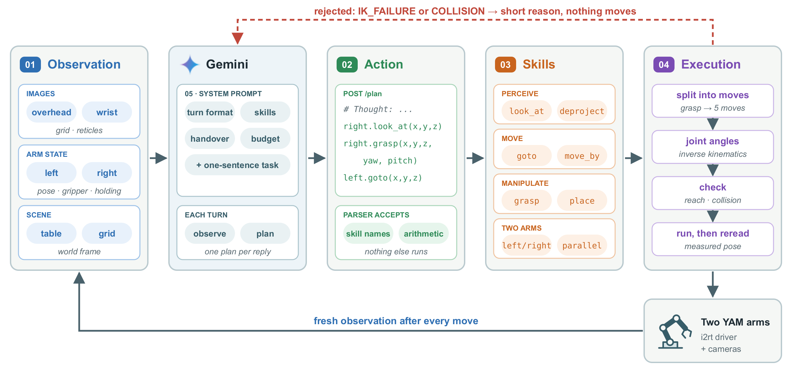
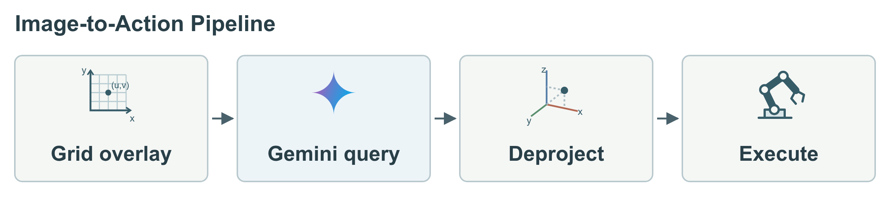
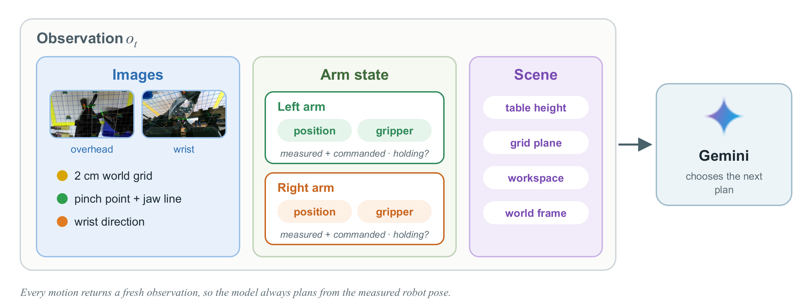
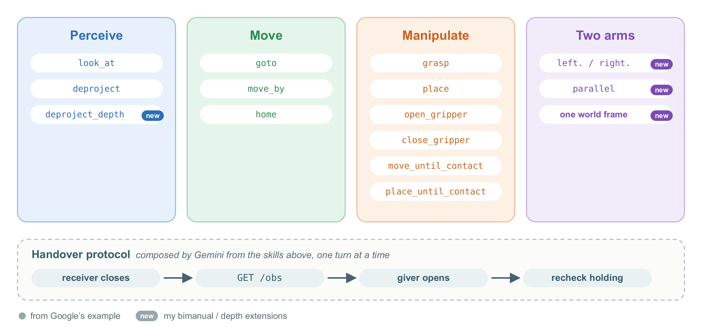

<h3 align="center">
  <picture>
    <source media="(prefers-color-scheme: dark)" srcset="assets/wordmark-dark.png">
    
  </picture><br>
  Zero-shot bimanual manipulation from calibrated images and motion skills
</h3>

<p align="center">
  <a href="https://developers.googleblog.com/gemini-4-argon-for-robotics/"></a>
  <a href="#how-it-works"></a>
  <a href="#in-simulation-no-hardware"></a>
  
</p>

<p align="center">
  
  <br><sub>The recorded clamp handover (played at 2.5&times; the speed in each caption).</sub>
</p>

A **harness** is everything around the model that lets it act on a robot: what
it sees each turn, how it answers, the skills it can call, how those calls
become checked motion, and the prompt that ties them together.

This is an open implementation of the harness in Google's
[Gemini 4 Argon robotics report](https://developers.googleblog.com/gemini-4-argon-for-robotics/),
extended to **two arms**. It is the code behind the case study *Open Gemini 4
Robot Harness: A Zero-Shot Bimanual Handover Case Study*. Each turn works like
this:

* **Observe.** Gemini sees calibrated camera images with a 2 cm world grid
  and a pinch-point reticle drawn on them, plus each arm's state.
* **Act.** It replies with a short program of motion skills
  (`right.grasp(...)`, `left.goto(...)`,
  `parallel(...)`).
* **Check and run.** The harness solves IK for every segment and checks it
  before it runs. It then returns a fresh observation, or a short reason the
  step was rejected.

<p align="center">
  
</p>

On the case study's rig (two YAM arms, an overhead ZED-M camera, a D405 on the
right wrist), Gemini handed over and placed a tape roll and a metal spring clamp
with no task-specific training or demonstrations. The final clamp run took
18 model turns. It recovered from five rejected proposals (four IK, one
collision) using only short feedback, and had no drops.

The release supports **human-checked and automatically checked execution**,
**both arms in one world frame**, **i2rt's MuJoCo sim and the real rig**, and
**full run records with an HTML report**.

The harness comes in **two versions**. They differ only in who checks each
motion before it runs:

| | `run_human_check.py` | `run_auto_check.py` |
|---|---|---|
| Who approves each step | You, in a viser 3D preview | `gap_guard`, automatically |
| What Gemini gets on a rejection | Your feedback text (e.g. `left arm would collide, change grasp pose`) | One word: `IK_FAILURE` or `COLLISION` |
| Used for | All recorded runs in the case study, including the successful clamp handover | Validated in simulation and on the scripted checks in `tests/` |
| System prompt | Byte-identical to the successful clamp run's prompt | The same prompt, with its two passages about the human operator replaced |

## Contents

- [How it works](#how-it-works)
- [The automatic checker (`gap_guard`)](#the-automatic-checker-gap_guard)
- [Install](#install)
- [Run](#run)
- [What a run records](#what-a-run-records)
- [Tests](#tests)
- [Layout](#layout)
- [Future work](#future-work)
- [Acknowledgements](#acknowledgements)

## How it works



1. **Grid overlay.** The overhead camera image (and the right-wrist D405, when
   it is calibrated) carries a 2 cm world grid, a pinch-point reticle with the
   jaw-closing line, and the wrist direction for each arm.
2. **Gemini query.** Gemini gets the images and the arm state, selects a pixel
   `(u, v)` and a height `z_plane`.
3. **Deproject.** The harness casts the pixel's camera ray into the right-arm
   base frame and intersects it with `z = z_plane`. This gives `x, y`. It does
   not measure the object's depth (`deproject_depth` reads stereo depth when you
   want that).
4. **Execute.** The target goes to a motion skill. The execution layer breaks it
   into segments, solves IK, checks each segment, runs it, and then reads the
   arm's measured state again.

The harness has five parts, matching the article.

**01 Observation** (`agent/observer.py`, `agent/wrist_view.py`,
`BimanualSession.observe`). This is what the model receives each turn: the
overhead and wrist images with the overlays; each arm's measured and commanded
end-effector position, orientation, gripper opening and `holding` flag; and the
table height, grid plane, current view and shared world frame. It contains no
point cloud or 3D model.



**02 Action** (`agent/plan_program.py`, `agent/robot_server.py`). Each reply is
one scene sentence, a `# Plan:` on turn 1, a short `# Thought:`, and exactly one
`curl` to the local robot server:

```text
curl -s -X POST http://127.0.0.1:8081/plan --data-binary @- <<'EOF'
x, y = right.deproject(u=0.52, v=0.48, z_plane=0.015)
parallel(right.grasp(x=x, y=y, z=0.015, yaw_deg=-35), left.goto(x=0.30, y=0.45, z=0.15))
EOF
```

The program is parsed, never executed as Python. Only known skill names,
numeric arguments, assignments from `deproject*` and simple arithmetic are
accepted. A reply that has no command, or that was cut off at the token limit,
is not run.

**03 Skills** (`agent/primitives.py`). Google's primitives, with their names and
arguments kept, plus the two-arm additions:

| skill | what it does |
|---|---|
| `look_at(x, y, z, grid_z, zoom)` | No motion. Re-centres and zooms the next overhead image. |
| `deproject(u, v, z_plane)` → `x, y` | Pixel → point on a horizontal plane. |
| `deproject_depth(u, v)` → `x, y, z` | Pixel → 3D surface point from stereo depth. *(extension)* |
| `goto(x, y, z, arc_z, yaw_deg, pitch_deg, azimuth_deg, roll_deg, speed)` | Straight-line move of the pinch center; optional arc. |
| `move_by(forward, left, dz, dyaw_deg, dpitch_deg, droll_deg, speed)` | Relative move. |
| `move_until_contact(dz, ...)` | Vertical guarded move. |
| `grasp(x, y, z, yaw_deg, pitch_deg, azimuth_deg, approach_height, speed)` | Open → above → descend → close until contact → lift. |
| `place(...)`, `place_until_contact(...)` | Above → descend → open → retreat. |
| `open_gripper()`, `close_gripper()`, `home()`, `done()` | |
| `left.` / `right.` prefixes | Every call names its arm. *(extension)* |
| `parallel(left.X(...), right.Y(...))` | Runs both arms' segments in lockstep. *(extension)* |

The handover is not a skill. Gemini composes it from these calls over several
turns, following the protocol in the prompt.



**04 Execution layer** (`agent/bimanual.py`, `agent/primitives.py`,
`yam_control/`). Each call is expanded into segments, which are IK-solved in the
arm's own base frame (left-arm targets are transformed by
`T_leftbase_rightbase`). Each step is checked, by you or by `gap_guard`, and
then streamed to the arms. After each step the harness re-reads the measured
state and re-resolves the rest of the plan from it. After any step, it also
rechecks `holding` on every arm, including an arm that did not move. A rejection
stops the remaining plan and returns the reason to Gemini.

**05 Prompt** (`agent/gemini_agent.py`, `bimanual_prompt()` in
`agent/bimanual.py`). The prompt has four parts: the turn format, the skill
definitions, the grasping and handover protocol (*the receiver closes →
`GET /obs` → the giver opens alone → recheck holding*), and the response budget
(`--time-budget-s`, `--thought-words`).

## The automatic checker (`gap_guard`)

`agent/gap_checker.py` sits in the operator's seat. For every step it builds a
MuJoCo collision world (`gap_guard/scene.py`) that contains both arms (i2rt's own
MJCF), the fingertips as convex pieces at each gripper's measured opening, the
right wrist D405 and its bracket, the table plane, and the latest overhead cloud
as a heightfield. It then answers:

- **`IK_FAILURE`**: the planner found no joint path (unreachable, outside the
  workspace), or a waypoint is outside the joint limits.
- **`COLLISION`**: along the trajectory the arm will actually be streamed,
  sampled in time, with the other arm moving on the same clock, some part makes
  contact (0 mm clearance of the convex hulls) with itself, the other arm, the
  table or the cloud. Other cases:
  - A grasp's descent and lift may touch the cloud with the fingertips, since
    that is the object.
  - Guarded moves are checked only against the arms.
  - Gripper open/close checks the finger sweep against the arms and the table.
  - A target below the table counts as `COLLISION`.
- **`OK`**: the step runs.

Only the verdict word goes back to Gemini. Each decision, with the contact pair
behind it, is logged to `runs/<stamp>/gap_checks.jsonl` and shown in a viser
panel.

It does **not** model the held object (points within 10 cm of a holding
gripper are dropped from the cloud), the left wrist camera (no CAD), or
anything the overhead camera cannot see. Meshes collide as convex hulls, which
errs toward `COLLISION` in concave spots. It also cannot tell whether a
receiving grasp will hold once the giver lets go. The handover protocol in the
prompt (observe before release, recheck holding) still covers that.

## Install

Python 3.12 (i2rt's `ruckig` dependency did not build on 3.10 here).

```bash
python3.12 -m venv .venv && source .venv/bin/activate
pip install -r requirements.txt
cp .env.example .env        # set OPENROUTER_API_KEY
```

Gemini is called through OpenRouter (`vlm/gemini_client.py`). Set
`OPENROUTER_MODEL` if the slug differs from `google/gemini-4-argon`.

On real hardware you also need the camera SDKs listed at the bottom of
`requirements.txt` (`pyrealsense2`, the ZED SDK's `pyzed`, and optionally
TRI Stereo from [raiden](https://github.com/tri-ml/raiden) cloned into
`third_party/raiden` for the default `--zed-method tri_stereo`).

## Run

### In simulation (no hardware)

Both arms run in i2rt's MuJoCo sim. The overhead image is a synthetic
table-and-block frame, ray-cast through the real calibrated camera pose
(`camera/synthetic_overhead.py`), so the grid, deprojection and collision cloud
line up with the arms.

```bash
python run_auto_check.py  --task "Pick up the red block with the right arm and lift it 10 cm."
python run_human_check.py --task "Pick up the red block with the right arm and lift it 10 cm."
```

Open the printed viser URL (default http://localhost:8090) to watch, or, in the
human version, to approve each step. The sim has no physical block, so a grasp
closes on air and reports `grasp_failed`. That is expected.

To drive `/plan` yourself without Gemini:

```bash
python run_auto_check.py --serve-only
curl -s http://127.0.0.1:8081/obs
printf 'right.goto(x=0.38, y=0.05, z=0.03, pitch_deg=90)\n' | \
  curl -s -X POST http://127.0.0.1:8081/plan --data-binary @-   # into the block -> COLLISION
```

### On the rig

1. Put your rig's values in `config/rig.yaml` (CAN channels, gripper travel,
   joint offsets, wrist camera serial) and your solved extrinsics in
   `config/extrinsics/`. Or set `RIG_CONFIG_DIR` to a directory with the same
   layout. The included files describe the case study's rig and are wrong for
   any other.
2. Bring both CAN buses up, and have the e-stops in reach.
3. Run with the settings of the successful clamp run:

```bash
python run_human_check.py --real --reasoning-effort minimal --time-budget-s 10 --thought-words 40 \
  --task "Pick up the clamp with the arm closest to it, hand it over to the other arm, then place the clamp inside the blue bin."

python run_auto_check.py  --real --reasoning-effort minimal --time-budget-s 10 --thought-words 40 \
  --task "..."     # asks you to type 'go': no human approves any motion
```

If the left gripper has no `gripper_limits` yet, measure them first with
`--real --measure-left-gripper` (the jaws sweep). If the agent crashes, both
arms stay powered and holding, and the robot server and viser stay up. **Ctrl+C
releases both arms (they go limp), so home them first.**

## What a run records

`runs/bimanual_<human|auto>_<stamp>/` contains:

- `run_meta.json`: argv, task, model, the full system prompt, git commit, plus
  `code.patch` and the `calib/` used.
- `gemini/`: every request and raw response, with the exact image bytes.
- `events.jsonl`: observations, plans, previews, decisions, execution results,
  watchdog events.
- `obs_*.png`, `state.csv` (joints, grippers, motor temperatures), `video/`,
  `scene.viser` (3D replay).
- `gap_checks.jsonl` (auto version only).

`python tools/run_report.py runs/<run>` builds a one-page HTML report: the
videos with event markers, the telemetry plots, and every Gemini turn with the
images it saw.

## Tests

```bash
pip install pytest && pytest tests/
```

The tests run against i2rt's sim and need no API key. They check that the two
prompts differ only in the operator passages, that the synthetic frame
deprojects correctly, and that the automatic checker returns `OK` over open
table, `COLLISION` for fingertips driven into the block and for one gripper
driven into the other arm, and `IK_FAILURE` for an unreachable target.

## Layout

```
run_human_check.py, run_auto_check.py   the two versions (thin wrappers)
agent/launch.py         shared launcher: arms, cameras, viser, robot server, Gemini loop
agent/bimanual.py       two-arm session, step building, human review viewer, prompt
agent/gap_checker.py    automatic checker (gap_guard as the operator)
agent/gemini_agent.py   agent loop + base system prompt
agent/primitives.py     skills -> segments -> IK; execution, holding checks
agent/observer.py       overhead overlay, look_at view, deproject
agent/wrist_view.py     calibrated wrist overlay + cloud
agent/plan_program.py   restricted program parser
agent/robot_server.py   GET /obs, POST /plan
agent/run_log.py, state_logger.py, cam_recorder.py, viser_screen.py   run records
gap_guard/              MuJoCo collision scene + fingertip convex pieces
camera/                 ZED overhead, D405 wrist, extrinsics, calibration loader, synthetic frame
yam_control/            i2rt-backed arm driver (FK/IK, streaming, guards), per-arm process
viz/                    robot meshes in viser
config/                 rig.yaml + solved extrinsics of the case-study rig
tools/run_report.py     HTML report of a run
```

## Future work

- **Adjust the context window.** Today every turn is appended to the
  conversation. Only images are pruned: frames older than the last few turns
  are replaced by a placeholder (`GeminiAgent._trim_images`). On long episodes
  the text history keeps growing, and with it latency and cost. Options to
  try:
  - summarising earlier turns into a short task-state note;
  - keeping only the last N turns plus the plan;
  - tuning how many turns keep their images.
- **Add more tasks.** The case study covers bimanual handover and placement.
  Natural next ones:
  - tool use, such as passing a tool and then using it;
  - reorienting objects, such as uprighting a mug;
  - longer pick-and-place sequences;
  - tasks where one arm holds a part while the other works on it.

  Each mainly needs prompt rules, as the handover protocol did, and sometimes
  a new skill.
- **Evaluate repeatability.** Fix the harness, repeat each object from varied
  starting poses, and report these separately: transfer success, final
  placement, drops, rejected motions and wall-clock time.
- **Reduce latency.** Median model response was 13 s against a 10 s budget.
  Cutting unnecessary observation turns, using smaller images, or streaming
  the reply would shorten episodes more than faster arm motion would.
- **Strengthen the automatic checker.**
  - Model the held object.
  - Add the left wrist camera's geometry.
  - Validate `run_auto_check.py` on recorded real-robot episodes, not only in
    simulation.
- **Port to other rigs.** Move the remaining YAM-specific pieces (i2rt
  driver, gripper model, camera wrappers) behind small interfaces so another
  arm or camera setup needs only a new backend and `config/`.

## Acknowledgements

The observation format, skills and turn format follow Google's
[Gemini 4 Argon for Robotics](https://developers.googleblog.com/gemini-4-argon-for-robotics/).
Arm driver and models: [i2rt](https://github.com/i2rt-robotics/i2rt).
Overhead depth: [TRI Stereo / raiden](https://github.com/tri-ml/raiden).
3D UI: [viser](https://github.com/nerfstudio-project/viser).
